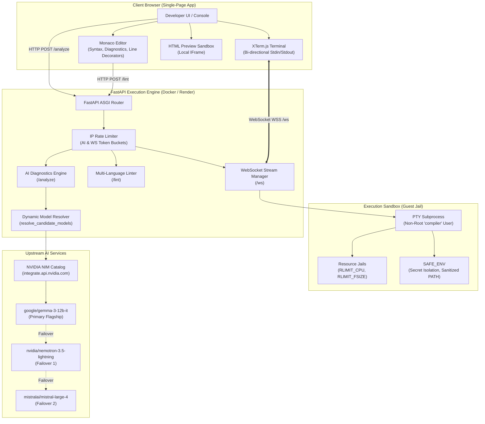

# System Architecture

This document describes the architectural design and execution lifecycle of **Intelligent Compiler**.

---

## 🏗️ High-Level System Architecture

The following diagram illustrates the end-to-end communication flow between the browser client, FastAPI backend, subprocess sandboxing jail, and upstream AI models:

---

## 🖥️ Frontend Architecture

The frontend is implemented as a single-page interface with zero heavy UI frameworks, optimized for instant loading and developer efficiency:

1. **Monaco Editor Integration:**
   - Provides VS Code-grade code editing, syntax highlighting, and inline diagnostic markers.
   - Listens to debounced change events to trigger real-time linting via `/lint`.
   - Supports automated patch application from the AI Diagnostics drawer.

2. **XTerm.js Bi-Directional Terminal:**
   - Establishes a WebSocket connection to `/ws` when the user clicks **Run** (or presses `Ctrl+Enter`).
   - Supports ANSI escape codes, terminal resizing, and raw interactive input (e.g. Python `input()`, C `scanf()`, interactive shell scripts).

3. **Responsive Matte Layout:**
   - Designed with a professional dark developer palette (slate gray borders, matte obsidian surfaces, crisp typography).
   - Features collapsible right-hand drawer for AI Diagnostics & Telemetry and bottom drawer for interactive execution logs.

---

## ⚙️ Backend Execution Engine

The backend is built with **FastAPI** running on **Uvicorn** with native WebSocket support:

### 1. Interactive PTY Execution (`/ws`)
- For interactive languages (Python, C, C++, Java, Node.js), execution runs inside a pseudo-terminal (PTY) pair using Python's `pty` module.
- Real-time `stdin` keystrokes from XTerm.js are routed directly to the guest process's slave PTY fd.
- `stdout` and `stderr` streams are piped back to the client over WebSocket chunks.
- When execution completes, exit code and timing telemetry are delivered.

### 2. Multi-Pass Linting Pipeline (`/lint`)
Static code checking is performed using isolated subprocesses tailored per language:
- **Python:** Syntax error tree analysis via `ast.parse` and style checks via `pyflakes`.
- **C / C++:** Syntax check passes via `gcc -fsyntax-only` and `g++ -fsyntax-only`.
- **Java:** Compilation checks via `javac -Xlint`.
- **JavaScript:** Syntax validation via Node.js `--check`.

Errors and warnings are mapped to 1-indexed Monaco markers (`{ line, col, endLine, endCol, message, severity }`).

---

## 🔒 Security & Sandboxing Architecture

To safely compile and execute arbitrary user code in a multi-tenant cloud environment, multiple layers of defense are enforced:

| Defense Layer | Implementation | Purpose |
| :--- | :--- | :--- |
| **Non-Root User** | `compiler` (UID 1000) inside Docker | Prevents host-level privilege escalation or container escape attempts. |
| **Secret Isolation** | `SAFE_ENV` dictionary | Guest processes do not inherit host environment variables (e.g. `NVIDIA_API_KEY` is completely inaccessible). |
| **CPU Limit** | `RLIMIT_CPU = 10s` | Kills infinite loops (`while(1)`) after 10 seconds of active CPU time. |
| **Disk Write Limit** | `RLIMIT_FSIZE = 5MB` | Prevents denial-of-service attempts via runaway file generation. |
| **Execution Timeout** | `asyncio.wait_for(timeout=10)` | Hard boundary on wall-clock execution time. |
| **IP Rate Limiting** | `IPRateLimiter` | Sliding-window limiter (10 AI requests/min, 40 execution runs/min per client IP). |

---

## 🧠 AI Diagnostics & Dynamic Failover

The `/analyze` endpoint integrates with NVIDIA NIM using an OpenAI-compatible interface:

1. **Dynamic Catalog Resolution:**
   - Rather than relying on hardcoded model identifiers that may deprecate, `resolve_candidate_models()` queries `https://integrate.api.nvidia.com/v1/models` dynamically.
   - It filters for active `-it`, `instruct`, and `lightning` text models.
2. **Cascading Model Fallback:**
   - Primary: `google/gemma-3-12b-it`
   - Secondary: `nvidia/nemotron-3.5-lightning-30b-a3b`
   - Tertiary: `mistralai/mistral-large-4-1t-a52b`
   - Quaternary: `z-ai/glm-5.3-flash`
3. **Structured Prompt Output:**
   - Prompt templates strictly enforce 4 distinct markdown sections: **Analysis**, **Complexity**, **Fixed Code** (annotated with `# FIXED:` / `// FIXED:` tags), and **Three Specific Improvements**.
